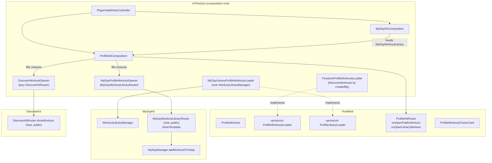

# Workouts on the profile — plan

A **Workouts** section on every profile, and on your own an **All workouts** library you can browse
without adding anything to a day. **Agreed in outline on 2026-11-11, not built.** Steps list what
changes in this repository (**App**) and in `InTheGym-CloudFunctions` (**Cloud**), the same shape as
`PROFILE_PLAN.md` and `DISCOVER_PLAN.md`.

This reverses one line of `PROFILE_PLAN.md`'s decisions table, "Public workouts were *not* chosen for
the profile". Update that table when step 4 lands.

---

## Why

The only way to see your own workouts today is MyDay → Add → Workout. That route is about putting
something on today, so someone who only wants to look, or to build one for next week, has to go
through an action they are not taking. Other people's workouts are only findable through DISCOVER,
never from the person who made them.

---

## Decisions

| Area | Decision |
|---|---|
| Rule kept | **Your own profile is what other people see, plus extras that only you get.** The Workouts section is identical for everyone; your own adds an **All workouts** button. |
| The section | That person's **public, visible** workouts, newest first: the same set DISCOVER lists for them. |
| All workouts | **Your own profile only.** Every template in your library, private ones carrying a **lock icon top-right** on the row. **View only: no Create button.** |
| Building | **Only from MyDay** (Add → Workout → create). Profile never starts the builder, decided 2026-11-11. |
| Opening a workout | **In the Workouts section, your own workout → a choice card**: "Open workout" (MyDay's page) or "View on DISCOVER". **Someone else's → straight to DISCOVER**, since you hold no copy (Save to Library is there). **In All workouts, every row → straight to the workout page**, public or private. The choice only appears in the section because every row there has a live DISCOVER card. All workouts reads the library, which still calls a moderated workout public after its card is hidden, so a choice there could offer a page that is gone. Decided 2026-11-11. |
| Clips | **Unchanged.** There is a separate plan for them later. |
| Three workout types | `WorkoutTemplateModel` (MyDayKit) is the workout. `DiscoverWorkoutCard` (DiscoverKit) and a new **`ProfileWorkout`** (ProfileKit) are each framework's own read model of it. No framework imports another. |
| What ProfileKit owns | The **list screens, the choice card and its model only**. It raises intent: open a public workout, open a library workout. |
| What MyDay owns | The **workout page, Add to Today and Schedule**, reached from Profile but still MyDayKit's screens, and the builder, which Profile does not reach. Adding to a day and scheduling write MyDay's day files and schedules, so they stay there. |
| What DISCOVER owns | The **public workout page** (ratings, comments, tags, report), reached from the profile's section. |
| Writes | **ProfileKit writes nothing.** Add to Today and Schedule write through MyDay's own managers, the same instances MyDay holds. No new Firestore path, so no `Users` rule change. |
| Add to Today from Profile | **Adds to today, whatever day MyDay has open** (step 1), then shows the existing confirmation card and **stays on Profile**. |

---

## Who points at whom

**Frameworks point at nothing.** Each one declares the protocols and closures it needs. Only the
composition root (the app target) imports frameworks, and it answers each framework's protocols with
an adapter. The two arrows between frameworks that look necessary (Profile → MyDay, Profile →
DISCOVER) are both a closure the app fills in, exactly as `DiscoverClipOpener` already does for clips.

Read the arrows as "knows about". No arrow leaves a framework box for another framework box.

---

## Step 1 — Add to Today always means today (App, MyDayKit) — built 2026-11-11

`addWorkoutToDay` is replaced by `addWorkoutToToday` (`MyDayManager+Workouts.swift`), with
`MyDayManagerAddToTodayTests`. A failed load of today saves nothing.

`MyDayManager.addWorkoutToDay(_:)` (`MyDayManager+Workouts.swift:13`) appends to **`selectedDay`**.
Inside MyDay that is safe: past days are read-only and hide Add. From Profile, MyDay can be on any
day. The workout would land on that day, and `MyDayFileManagerSaver` names its file by
**today's** date, so the save could overwrite today's file with a past day's content.

- Add `addWorkoutToToday(_:)`: load today's day (the manager already does this for the strip), append,
  save, and if `selectedDay` is today, update it so MyDay redraws.
- The template page's Add to Today calls it. `addWorkoutToDay` stays for anything that really means
  the selected day, or goes if nothing does.
- **Tests** (`MyDayKitTests`): adding while a past day is selected writes today and leaves the past day
  untouched; adding while today is selected updates `selectedDay`.

## Step 2 — A public way into MyDay's workout screens (App, MyDayKit)

`MyDayWorkoutCoordinator` is internal and starts at the library. Add a **public
`MyDayWorkoutLibraryRouter`**, built like `MyDayDemoWorkoutRouter`: it pushes onto any navigation
controller and exposes:

- `showTemplate(id:)`: the existing `MyDayWorkoutTemplateDetailScreen`, Add to Today and Schedule
  included. Its confirmation then **pops back to the screen it was pushed from**, not to MyDay's root.

Nothing else: **the builder is not exposed**, since building starts only from MyDay.

`MyDayKitComposition` builds it from **the same instances MyDay uses** (library manager, day manager,
schedule manager) and hands out a factory beside `workoutLibrary`. A second day manager would add a
workout MyDay does not see until relaunch, and a second schedule manager would hold schedules MyDay's
due cards never read.

## Step 3 — A public way into DISCOVER's workout page (App, DiscoverKit)

Add `DiscoverKitRouter.showWorkout(_ card: DiscoverWorkoutCard)` beside `showClip(_:)`, pushing
`.workoutDetail`. Nothing else in DiscoverKit changes.

## Step 4 — ProfileKit: the model, the section, the library screen (App, ProfileKit)

- **`ProfileWorkout`**: `id`, `title`, `exerciseCount`, `createdAt`, `isPublic`, and optional
  `ratingCount` / `ratingSum` / `commentCount` / `tags` (present on public cards, absent on library
  rows). **Every optional stays optional**, the same reason card counts are.
- **`ProfileWorkoutsLoader`**: `publicWorkouts(of userId:, limit:)`.
- **`ProfileLibraryLoader`**: `allWorkouts()`. Re-read every time All workouts appears, so a workout
  built in MyDay since the last visit is listed.
- **Router closures**: `onOpenPublicWorkout: ((ProfileWorkout) -> Void)?` and
  `onOpenLibraryWorkout: ((String) -> Void)?`. **`nil` hides the thing it would open**, as
  `onOpenGettingStarted` does, so routers built for DISCOVER or the legacy callers show the section
  but no All workouts, and never the choice card.
- **Where a tap goes is decided in one place**, a `ProfileWorkoutDestination` worked out from which
  list the row is in, whose workout it is, and which closures are set: `.choice`, `.workout` or
  `.discover`. Section + yours → `.choice` (or `.discover` when there is no library closure); section +
  someone else's → `.discover`; All workouts → `.workout`. Both lists read it, so neither re-derives
  the rule.
- **`ProfileWorkoutChoiceCard`**: a centred card over a dim, presented from `.overlay { }`, with two
  full-width rows, **Open workout** (Add to Today, Schedule) and **View on DISCOVER** (ratings,
  comments), plus a quiet Cancel. It is built in ProfileKit's own vocabulary on the shape of
  `WorkoutSessionDialogOverlay`. A tap on the dim dismisses it. It is not a system action sheet,
  which would read as another app.
- **`ProfileWorkoutsSection`** on both `MyProfileScreen` and `UserProfileScreen`, between highlights
  and clips. It shows up to three rows plus "See all", and on your own profile also shows
  **All workouts** in its header. Someone else's empty section is not drawn; yours is, so the button
  still has somewhere to live.
- **`ProfileWorkoutRow`**: a copy of `DiscoverWorkoutRow` (title, date, exercise / rating / comment
  pills, tags), drawn with ProfileKit's card chrome. It is a deliberate duplicate across a module
  boundary. **Add it to the Keep in step index.**
- **`ProfileAllWorkoutsScreen`**: the whole library, newest first. A private row carries a
  `lock.fill` in its top-right corner. No bottom button. Empty, it says workouts are built from
  MyDay, rather than offering to build one.
- **Tests** (`ProfileKitTests`): section view model (empty / loaded / failed, own vs other), library
  view model reload-on-appear, the lock shown exactly when `isPublic` is false, and
  `ProfileWorkoutDestination` for each case (section + own → choice, section + someone else's →
  DISCOVER, All workouts public or private → workout), plus "no library closure → never the choice". `makeSUT` tracks leaks,
  per *Testing*.

## Step 5 — The adapters and wiring (App, composition root)

New files in `InTheGym/Launch/Composition/ProfileKit/`, one per file:

- `FirestoreProfileWorkoutsLoader`: `DiscoverWorkouts` where `createdBy == uid`, `isPublic == true`,
  `status == "visible"`, ordered by `createdAt` desc, the shape of `FirestoreProfileClipsLoader`.
- `MyDayLibraryProfileWorkoutsLoader`: reads `MyDayWorkoutLibrary.manager` (local-first, unsynced
  workouts included) and maps `WorkoutTemplateModel` → `ProfileWorkout`.
- `DiscoverWorkoutOpener`: like `DiscoverClipOpener`, it **builds the DiscoverKit router lazily on
  the first tap** (eager construction recurses) and holds the navigation controller weakly. It
  passes the workout library through, so Save to Library works on someone else's workout.
- `MyDayProfileWorkoutOpener`: holds a `MyDayWorkoutLibraryRouter` built on the profile's stack.

`ProfileKitComposition.composeCombination` and `makeRouter` take
`workoutLibrary: MyDayWorkoutLibrary?`. `PlayerInitialViewController` passes `myDayKit.workoutLibrary`
(Profile is already composed after MyDay). DISCOVER's `ProfileKitUserProfileOpener` and the legacy
`UserProfileCoordinator` pass `nil`.

## Step 6 — Index and rules (Cloud)

- **`firestore.indexes.json`**: `DiscoverWorkouts (createdBy ASC, isPublic ASC, status ASC, createdAt DESC)`.
  The emulator does not enforce composite indexes, so a missing one only fails in production.
- **Rules**: no change expected. The `DiscoverWorkouts` read rule already requires the `isPublic` /
  `status` filters this query carries. Add a test in `firestoreRules.test.ts` that the query is
  allowed and one without `isPublic` is refused.
- Deploy from the `InTheGym-CloudFunctions` root:
  `firebase deploy --only firestore:indexes,firestore:rules`. **Before** the app build ships.

---

## Open questions

1. **Private accounts.** Recommended: workouts stay visible to non-followers, as public clips do,
   because they are public on DISCOVER anyway. Alternative: gate them like highlights.
2. **A workout count in the header**, beside clips. Not in this plan. It needs a recount on `Profiles`
   (`profileWorkoutCount`) in the functions.
3. **Making a workout public or private from All workouts.** Not in this plan. Today visibility is set
   only in the builder's settings sheet.

---

## Rollout checklist

- [ ] Step 6 deployed (index built in the console, rules test green)
- [ ] All workouts lists a workout saved offline (local-first read)
- [ ] Add to Today from Profile while MyDay is on a past day: lands on today, past day unchanged, today's file intact
- [ ] Workout built in MyDay appears in All workouts on the next visit, without relaunch
- [ ] Own workout in the section → choice card; both rows open the right page; dim and Cancel dismiss
- [ ] Any row in All workouts → workout page directly; someone else's in the section → DISCOVER directly
- [ ] Someone else's profile shows their public workouts; the page opens in DISCOVER with Save to Library
- [ ] A hidden (moderated) workout is absent from the section
- [ ] Dark mode on the section, row and All workouts screen
- [ ] `CLAUDE.md`: PROFILE section, Keep in step index (`ProfileWorkoutRow` ↔ `DiscoverWorkoutRow`), `PROFILE_PLAN.md` decisions table
